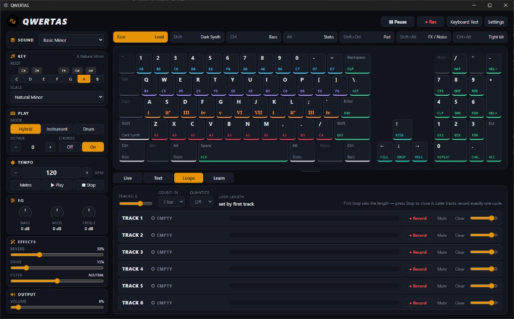

# QWERTAS



QWERTAS turns a computer keyboard into a software-defined musical instrument. It combines physical-key
performance, purpose-built Web Audio synthesis, typed scores, guided practice, layered loops, and master recording
in a local Electron application.

[Product website](https://qwertas.nrek.co) · [Source repository](https://github.com/nrek/qwertas)

QWERTAS is an active prototype. The source is usable and tested, but public binaries are not yet signed,
notarized, or published as stable releases.

## Overview

The application runs locally with no backend, account, cloud service, sample library, or telemetry. Its renderer is
React and TypeScript; Electron owns the desktop window, file dialogs, and recording saves; the Web Audio API
provides synthesis, effects, mixing, timing, and recording.

## Core function

Learn to music like you learned to type. The PC keyboard is the instrument: **DVORAQWERTAS** (default) puts ASDF as
the primary chromatic register with QWERTY/ZXCV as adjacent rows; **QWERTORAS** is an optional ergonomic map.
Modifiers hot-swap instrument layers; Space/Enter/Backspace are kick/snare/clap; the numpad is a drum machine.
Premium synthetic families (Pristine / FM / Spectral / Transient) sit alongside the classic voices. On top of live
play you can **pause** to type normally, **type** music as plain text, run a **2–8 track** loop station (default 4),
choose **High/Ultra** Web Audio quality, pick an output device when the runtime allows, and **record** to disk. Not a DAW.

## Run it

```bash
git clone https://github.com/nrek/qwertas.git
cd qwertas
npm ci
npm run dev        # Vite + Electron with hot reload
# or
npm start          # build once and launch Electron
```

Press any key (or click) to enable audio, then play.

Requirements: Node.js 22 or newer, npm, and a desktop operating system supported by Electron.

## Desktop exports

```bash
npm run dist:win    # Windows x64: NSIS installer + portable ZIP
npm run dist:mac    # macOS x64 + arm64: DMG + ZIP
npm run dist:linux  # Linux x64: AppImage + DEB
```

Build each release on its matching operating system: Windows on Windows, macOS on macOS, and Linux on Linux. macOS
exports cover Intel and Apple silicon; Windows and Linux currently target x64. Artifacts are written to `release/`.

The builds are unsigned. Windows SmartScreen shows "Windows protected your PC"; macOS Gatekeeper blocks an
unnotarized app by default. Code signing, Apple notarization, Linux repository signing, checksums, and automated
GitHub Releases publishing remain release work—not packaging claims.

The Windows installer installs per-user, allows the destination folder to be selected, and adds Desktop and Start
Menu shortcuts. The bundled `examples/*.qwertas` ship under `resources/examples`, and **Import score** opens that
folder by default on every platform.

To create and smoke-test an unpacked Windows app:

```powershell
npm run dist:win:dir
$env:QWERT_SMOKE = "1"
& "release\win-unpacked\QWERTAS.exe"
```

Packaged smoke artifacts go to the platform's Electron `userData` directory because the application archive is
read-only.

Source: <https://github.com/nrek/qwertas>.

## Workflows

| I want to… | Do this |
|---|---|
| Play | Just type on the keyboard (Live tab shows what you're playing) |
| Shape the instrument | Left **control pane**: Sound (profile), Key (root piano + scale), Play (mode/octave/chords), Tempo, EQ dials (drag, scroll, double-click = 0 dB), Effects, Output |
| Change layout / quality / output | **Settings** — DVORAQWERTAS / QWERTORAS / Classic, Unified vs Layered rows, High vs Ultra, output device |
| Use the keyboard normally | **Pause** (top bar, `Pause/Break` or `F12`). Clicking into any text box pauses automatically; `Esc` resumes |
| Type a score | **Text** tab → type deterministic durations such as `z:1 .:1 x:4` → **Play** |
| Learn a song | **Learn** tab → **Start** → hold each highlighted key for its written length (`w:4` = hold W four grid units); the score waits for you |
| Import sheet music | **Text** tab → **Import Score** → choose a UTF-8 `.qwertas` or `.txt` file (1 MiB max) |
| Loop a typed beat | Text tab → **Send to track 1–4** |
| Record a loop | **Loops** tab → **Record** on an empty track → play → **Stop** (first loop only) |
| Layer | Record the next empty track — it records exactly one cycle, starting at the next loop boundary |
| Play over loops | Keep playing live; loops keep running |
| Capture everything | **● Rec** (top bar) → perform → **■** → **Save** (or Discard) |

## Live keyboard

| Keys | Hybrid mode (default) |
|------|------------------------|
| `1 … =` (number row) | High register — lead |
| `Q … ]` | Upper-mid — melody (profile base instrument) |
| `A … '` | Mid — scale-locked chords (Chords: On) or notes |
| `Z … /` | Low — bass |
| `Space` / `Enter` / `Backspace` | Kick / snare / clap |
| `Right Shift` / `\` | Open hat / closed hat |
| Arrows | FX: ↑ riser, ↓ drop, ← tom fill, → snare roll |
| Numpad | 7 crash · 8 open hat · 9 ride · 4 clap · 5 snare · 6 rim · 1 kick 2 · 2 kick · 3 tom · `/` hat · `0` repeat last hit (hold) · `.` choke · `Enter` accent (hold) · `+`/`-` drum velocity |

| Hold | Layer |
|------|-------|
| — | Base |
| Left Shift | Shift (e.g. Lead) |
| Ctrl | Ctrl (e.g. Bass) |
| Alt | Alt (e.g. Stabs) |
| Shift+Ctrl | Pads |
| Shift+Alt | FX / noise |
| Ctrl+Alt | Alternate drum kit on the whole keyboard |

Modes: **Hybrid** (rows have roles), **Instrument** (all rows melodic with the layer instrument; Right Shift is a
normal Shift), **Drum** (all main rows are pads). **Keyboard Test** is a silent screen showing every physical key
currently detected — use it to find your keyboard's rollover/ghosting limits.

## Text syntax

Text uses the **same mapping as live play** — a letter means "press that key".

| Write | Means |
|---|---|
| `@tempo 108` / `@grid 1/16` | Set exact score timing (also supports `@title`, `@root`, `@scale`, `@profile`) |
| `z x c v` | Press Z, X, C, V (one grid unit each). Spaces and newlines take no time; `zxcv` is the same |
| `z:4` | Press Z for exactly four grid units |
| `.` / `.:4` | Rest for one unit / four units |
| `-` | Hold the previous note (or rest) one more step: `z---` |
| `\|` | Bar line — visual only, no time |
| `<KICK>` / `<KICK>:2` | Named drum and score spacing (also `<SNARE>`, `<HAT>`, `<CLAP>`, `<RIM>`, `<TOM>`, `<OHAT>`, `<CRASH>`, `<RIDE>`, `<KICK2>`) |
| `{base}` `{shift}` `{ctrl}` `{alt}` `{shift+ctrl}` `{shift+alt}` `{ctrl+alt}` | Modifier layer for the keys that follow |

Letters are case-insensitive. `.` and `-` mean rest/hold, so the Period and Minus keys can't be written literally.
Unknown characters are underlined and reported as validation errors. Examples:

```text
{base} z x c v | z x c v
q..w..e..r
a-s-d-f
<KICK> . <SNARE> . <HAT> . <HAT> .
```

The parser normalizes shorthand and explicit durations into one score model. Playback uses score time
(`startUnit × grid duration`) on the shared AudioContext look-ahead scheduler. Invalid scores remain editable,
show line/column errors, and cannot play until corrected. Unknown directives are preserved with a warning.
Bundled examples live in `examples/`; `beethoven-5-opening.qwertas` is the golden timing fixture.

## Learn

Learn uses the same score as the Text tab (type it, or **Import Score** once in either tab). Instead of playing
the score, it highlights the physical key the score is waiting for, plus any modifiers its `{layer}` needs.
Hold that key for the written duration — `key:N` × the score's tempo/grid — and the score moves on. While held,
the key lights in its own row colour and fades back to the key face at exactly the rate of the required hold, so
it is fully faded the moment the note is done. The editor scrolls to keep the active line in view, like a typing test. Releasing early resets that note, wrong keys never advance, and a repeated note needs
a fresh press. Rests advance on their own after their length. Every key you press still sounds through the
normal live instrument. Try `examples/ode-to-joy-complete-theme.qwertas`.

## Loops

- **2–8 tracks** (slider in Loops; default 4). Reducing the count hides higher lanes without deleting their
  events for this session. A loop is stored as **performance events** (keystroke metadata + pitch-canonical fields + a snapshot of profile,
  root, scale, mode), not audio — it replays through the same mapping as live play.
- The **first loop sets the cycle length** (rounded to whole beats). Every later track records **exactly one
  cycle**, starting on the next cycle boundary. Optional count-in (Off / 1 bar / 2 bars) and quantize
  (Off / 1/4 / 1/8 / 1/16 — applied to note starts; note lengths are preserved).
- Per track: Record · Stop/Play · Mute · Clear · Volume. Clearing one track never interrupts the others.
- Global transport: **▶** (start clock + every stopped loop), **■ Stop All**, BPM, Metro (metronome is never
  recorded).
- Limitations: changing BPM re-times text playback and the metronome, not already-recorded loops; numpad
  repeat/accent/velocity gestures are live-only (not stored in loops).

## Master recording

Records exactly what you hear (post-limiter, without the metronome) and saves three files side by side:

```text
performance-<date>.webm          WebM / Opus audio
performance-<date>.events.json   every performed event (live, text, track:N) with time in ms
performance-<date>.json          manifest: profile, root, scale, mode, bpm, duration, layers, loops (+ events)
```

Master recording and loop recording are separate: master = final output, track record = loop content.

## Repository layout

```text
qwertas/
  electron/          main.ts (window, score-open + recording-save IPC, smoke harness), preload.ts
  examples/          importable .qwertas scores; Beethoven 5 is the golden fidelity fixture
  src/
    app/             App.tsx, session.ts (wiring, Play/Stop All, text→loop), store.ts, styles.css
    audio/           engine.ts (AudioContext, voices, buses, record tap, metronome), curves.ts
    drums/           kits.ts, drumSynth.ts (synthesized one-shots)
    instruments/     voices.ts (synth voice definitions)
    keyboard/        controller.ts (live keys → performer; pause; loop capture), geometry.ts
    mappings/        zones.ts, layers.ts, profiles.ts, resolve.ts (pure key → action)
    performance/     types.ts (PerformanceEvent, ContextSnapshot), performer.ts (event → sound at time t)
    text/            tokenizer.ts, normalized score model/parser, scheduler.ts (TextPlayer)
    learn/           coach.ts (pure hold-to-advance state machine), session.ts (store + tick)
    loops/           transport.ts (one look-ahead clock), track.ts, recorder.ts (LoopStation), loop-events.ts, types.ts
    recording/       master-recorder.ts, performance-events.ts
    scales/          scales.ts
    ui/              TopBar, ControlPane, StatusPanel, KeyboardView, LivePanel, TextPanel, LoopsPanel, KeyboardTest, SettingsDialog
  tests/             vitest unit tests (mapping scenarios, scales, text parser, loop events)
```

Design rules: live, text and loops all produce `PerformanceEvent`s that go through one `Performer` → `AudioEngine`
path. Text and loops are scheduled by the single `transport` clock (AudioContext look-ahead, no per-track timers).
Parser and scheduler are separate; the audio engine knows nothing about React.

## Contributing surfaces

| Add a… | Edit |
|---|---|
| Profile | `src/mappings/profiles.ts` |
| Scale | `src/scales/scales.ts` (`SCALES`) |
| Drum kit | `src/drums/kits.ts` (`KITS`) |
| Synth voice | `src/instruments/voices.ts` (`VOICES`) |
| Key mapping / zones | `src/mappings/zones.ts` |
| Text syntax | `src/text/tokenizer.ts` + `src/text/parser.ts` (+ tests in `tests/text.test.ts`) |

## Tests

```bash
npm test             # vitest: mapping scenarios, scale lock, text parser, loop timing/quantize/tiling
npm run typecheck
npm run test:smoke   # builds, launches an invisible Electron window, drives: live play, blur, pause,
                     # typed beat + cursor, text→loop, layering Track 2, clear, master record + save.
                     # Writes screenshots and a saved take to tests/artifacts/
```

## Out of scope (by design)

No DAW features: no piano roll, timeline, arrangement, mixer, rewind/markers, MIDI editing, plugins, accounts or
cloud. Not a piano emulator and not a clone of any hardware loop station.

## Contributing

Bug reports and focused pull requests are welcome. Start with [CONTRIBUTING.md](CONTRIBUTING.md), which documents
the development workflow, architecture boundaries, test requirements, and contribution expectations.

## Security

Do not open public issues for vulnerabilities. Follow the private reporting process in
[SECURITY.md](SECURITY.md).

## License

QWERTAS is released under the [MIT License](LICENSE.md).
